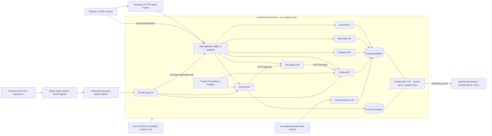

# P23 — Course submission and final handoff

Stellar Atlas demonstrates the required DevOps topics on one existing Windows
laptop, with the Gaia EDR3/GCNS catalog and separate Catalog/Journey services.
P00–P23 have course-sized evidence under ADR 0005. Read the
[final acceptance register](ACCEPTANCE.md), [Batch 7 results](BATCH7_REPORT.md)
and [remaining limits](#remaining-limitations) before presenting this as a demo.

Current source topology: [six backend services](SIX_SERVICES.md), accepted in
[ADR 0006](adr/0006-six-application-services.md). See [Batch 9](BATCH9_REPORT.md)
for current refactor evidence; earlier runtime measurements below remain historical.

## Architecture



Terraform owns platform resources; Argo owns application deployment after P17.
Only Web is public. Databases, Kubernetes, Argo and monitoring remain private.
No operator or cluster credentials, state or backups are committed or passed to
release Actions. CI uses disposable database credentials. No signing/SBOM or network
policy enforcement is claimed. Dependency pins/locks are in
`tools/toolchain.lock.json`, `tools/locks/` and npm locks; original code uses
[MIT](../LICENSE), and data retains its [own attribution/license](../data/LICENSE-NOTICE.md).

## Course-topic evidence

| Topic | Demonstrated evidence |
|---|---|
| Microservices | [Batch 2](BATCH2_REPORT.md): real Journey→Catalog HTTP, SQL role denials and separate contracts; [Batch 6](BATCH6_REPORT.md): independent Journey pod replacement. |
| Docker | [Batch 3](BATCH3_REPORT.md): fresh Compose, health checks, pinned/non-root images, persistence; [Batch 5](BATCH5_REPORT.md): four anonymously readable GHCR digests. |
| IaC | [Batch 4](BATCH4_REPORT.md): kind, two Terraform roots, apply/no-change plans and detected/repaired label drift. |
| Kubernetes | [Batch 6](BATCH6_REPORT.md): pod recovery 7.220 s, Argo replicas 1→2→1, retained-node persistence. Single node, no HA claim. |
| CI/CD | [Batch 5](BATCH5_REPORT.md): failed-test gate, protected-main checks, published release, GitOps and normal Git rollback. [Current actions](https://github.com/Jyot-Kikani/DevOps_Assignment/actions). |
| DevSecOps | [P19](P19_SECURITY_SUMMARY.md): Gitleaks and rejected fake token, non-root/private routes; [Grype review](P10_IMAGE_REVIEW.md) retains failed strict thresholds. |
| Operations/recovery | [P21 runbook](P21_OPERATIONS.md): start/stop/update/rollback/import/common failures; [P14](P14_MONITORING_RECOVERY.md): private metrics/dashboard, host dumps and isolated restore. |
| Public access | [Batch 5](BATCH5_REPORT.md): external phone/mobile-data check; Batch 7: final same-host HTTPS browser/API smoke. New temporary hostname after restart. |
| Product/data | [P22](P22_FINAL_REVIEW.md): desktop/mobile core flows and counts; [Batch 2](BATCH2_REPORT.md): byte/checksum/atomicity/retention evidence. |

## Versions, public route and backup

The [Batch 7 report](BATCH7_REPORT.md) records the exact observed running source,
release, deployment revision, current temporary URL and CI/PR links. The source
commit of a running image can differ from later documentation commits; inspect
`/about`, `/version.json`, `/release.json` and `gitops-check` to verify it.

Dataset: `gcns-edr3-20261013-20271720`, J2016.0, raw SHA-256
`20271720bc7b5038f05df0c25d17a5e1cc51158eed74ee1b27472c7faf4ede94`.
Stored rows **331,312**; principal 100-pc map **300,526**; default 50-ly map **1,151**.
[Public frozen data and notices](https://github.com/Jyot-Kikani/DevOps_Assignment/releases/tag/data-gcns-edr3-20261013).

Verified Batch 4 host backup is under `.local/backups/20261020T204752775608Z/`:
`stellar_catalog.dump` (38,100,340 bytes), `stellar_journey.dump` (9,892 bytes),
and `manifest.json` with SHA-256s. It was restored to a unique isolated target;
it predates later demo shares. Preserve it; it is not a backup of today's shares.
For a new current checkpoint, run `backup` explicitly before destructive work.
Normal shutdown retains the node/PVC; no teardown is needed for assessment.

## Reproduction and operating sequence

First-time checkout: follow [README bootstrap](../README.md), then the P12/P13/
P15/P17 guides in order. Supply your own authenticated operator/zero-cost account
evidence; clone contents cannot contain this operator's local credentials or state.
A clean-source/lock check is useful but does not establish a second live platform.
Routine startup applies to the retained, already initialized GitOps node:

```powershell
python tools/run.py demo-start --json
python tools/run.py gitops-check --json
python tools/run.py smoke --target public --json
# At the end, if you want to close the demonstration:
python tools/run.py demo-stop --json
```

Use `demo-start --local-only` to avoid opening a public route. Keep Docker Desktop
running in Linux-container mode. Use this project's kubeconfig
`.local/kubernetes/config`; preserve unrelated clusters. Never rerun manual
`demo-bootstrap` after Argo owns the app. [P21](P21_OPERATIONS.md) covers troubleshooting,
release/rollback and safe shutdown; [P14](P14_MONITORING_RECOVERY.md) covers backup/restore.
Guarded teardown means first verify a host backup and explicitly name the target;
this submission performs no destructive deletion/rebuild.

## Assessment script (about eight minutes)

1. Run `gitops-check`; show Argo Synced/Healthy, source/release and private
   services. Open the current public `/explore` URL. Explain that the laptop is
   the server and the route is temporary.
2. Show **1,151** catalog objects at 50 ly. Orbit/zoom, toggle labels/rings/plane,
   and select Proxima with search. Show distance/uncertainty, epoch, source and
   five neighbors measured from the selected object. Select 326.16 ly to show
   **300,526**, then return to 50 ly.
3. Set the Sun as measurement origin, select Proxima, and show **4.24638 ly**.
   Use View from here and Return to Sun; share/reopen a view. Positions are
   measured; sizes/colors and alternate-view brightness are illustrative.
4. Plan Sun→Proxima at **0.1c**: **42.4638 Julian years**. Play/pause/scrub the
   explicitly illustrative 20-second animation. Save, create the anonymous
   30-day share and reopen it. Explain no acceleration/gravity/relativity model.
5. Open Saved and About. Show browser-local storage limits, source/release/data
   checksum, attribution and conditional availability. On a narrow browser,
   demonstrate the searchable list/profile/journey layout.
6. Show the course evidence table: protected PR CI, release/Grype findings,
   deployment and Git rollback, Terraform drift, pod replacement/scaling,
   private monitoring and isolated restore. Reuse the recorded outputs; do not
   repeat destructive or expensive demonstrations merely to show the evidence.
7. Run final public smoke. If finished using the host, use `demo-stop`; next
   start produces a new hostname, so copy new links. Do not delete the cluster.

## Remaining limitations

- Availability requires this host, Docker, kind, cloudflared and internet. One
  node/PVC is not HA. Stop took a 60-second grace period and exit 137 in Batch 6;
  persistence passed after recovery, but that is not a clean DB shutdown claim.
- Grype strict high-severity thresholds remain failed; the final scan includes
  Web 91 High/17 Critical, Catalog 55 High/0 Critical and Journey/Importer each
  55 High/1 Critical (certifi version match). Actual findings and the unchanged
  historical advisory review are documented. CI success does not certify a
  vulnerability-free image.
- P22 uses one software Chromium and mobile emulation. The earlier physical
  external-phone check is historical; no fresh external-device/FPS/load or
  complete accessibility certification is claimed.
- Cost/configuration review uses existing hardware, local tools, public source/
  packages and accountless tunnel. P00's user-supplied Free/$0 budget evidence
  is reused; no fresh account billing/MFA inspection is claimed by Batch 7.
- The clean-clone check is bounded to source/locks/CLI, with no new cluster or
  full environment installation. There is no automatic disaster recovery.
- Shared journeys expire; local saves do not sync. Catalog epoch/probabilistic
  limits and data noncommercial license remain visible. Optional signing/SBOM,
  custom networking, multi-host HA and strict load/FPS gates are outside scope.
